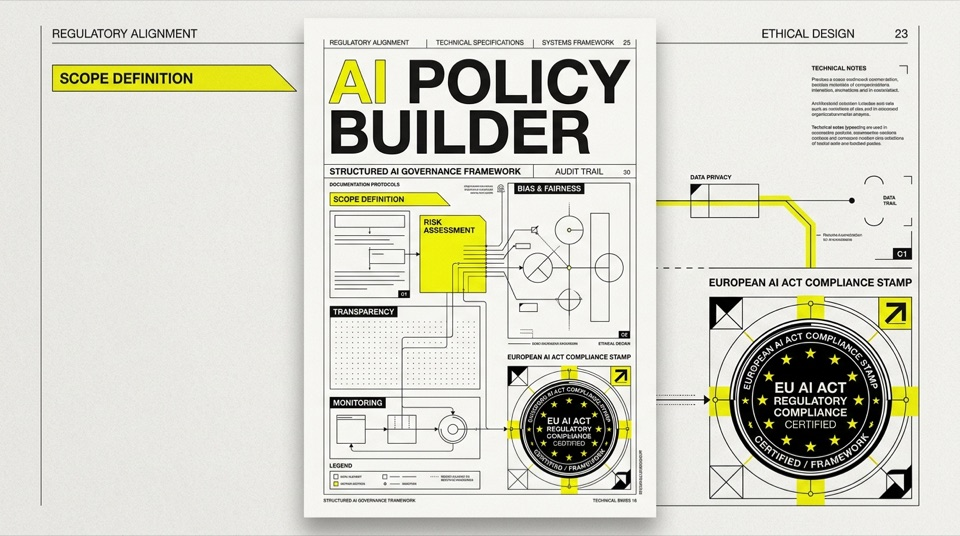

# AI Policy Builder — Client-Side EU AI Act Governance Wizard

<p align="center">
  
</p>

> **Your company's internal AI policy draft in three guided steps.**  
> A zero-server, privacy-first web application designed for European SMEs, studios, and corporate teams to establish pragmatic guidelines for responsible AI adoption in compliance with the EU AI Act (Regulation EU 2024/1689).

[](https://emaf205.com/ideas/ai-policy-builder/)
[](https://github.com/emaf205/ai-policy-builder)
[](LICENSE)

---

## ✦ The Genesis & Why This Exists

In my consulting and corporate training work across Italy and Europe, I witness organizations falling into one of two dangerous traps regarding Artificial Intelligence:

1. **The Blanket Prohibition Trap**: Management issues a strict ban on ChatGPT and generative tools. Result? Employees use personal smartphones and unvetted browser tabs in secret, pasting sensitive client data into unknown clouds without encryption or corporate oversight.
2. **The Anarchic Wild West Trap**: Teams adopt dozens of disjointed AI tools without documentation, exposing intellectual property, violating GDPR confidentiality clauses, and breaching forthcoming EU AI Act transparency rules.

Neither approach works. Companies do not need 80-page incomprehensible legal treatises: they need a **clear, pragmatic, 14-section internal operating policy** that employees can actually read and follow.

I engineered **AI Policy Builder** as a single-file, zero-tracking web tool that guides leadership through key operational choices and compiles a tailored, editable draft policy in less than 5 minutes.

---

## ✦ How the Wizard Works

The application breaks policy drafting into three logical stages:

1. **Stage 1: Organization Baseline**: Company identity, industry sector, team size, and existing confidentiality frameworks (GDPR, ISO 27001).
2. **Stage 2: AI Workflows & Tool Matrix**: Approved vs. prohibited tools (ChatGPT Team/Enterprise, Copilot, Midjourney, Claude, local LLMs), classified data tiers, and specific forbidden activities (e.g. uploading raw customer PII or proprietary source code).
3. **Stage 3: Governance & Accountability**: Oversight roles, human-in-the-loop review mandates, incident response protocols, and regular review cadences.

> **Zero Hallucination Guarantee**: Missing corporate decisions are flagged prominently with `[TO BE DEFINED BY MANAGEMENT]`. The software refuses to invent business commitments on your behalf.

---

## ✦ Core Features & Engineering Principles

- **🔒 100% Client-Side & Zero Exfiltration**:
  - All form state, data processing, and document rendering take place purely in your browser's local memory.
  - Zero analytics, zero backend database, zero data transmission over the wire. Confidential corporate disclosures never leave your device.
- **📄 Multi-Format Export Engine**:
  - **Microsoft Word (.docx)**: Pre-styled with formal corporate headers and typography.
  - **Clean Markdown (.md)**: Ideal for technical wikis, GitHub repos, and Notion hubs.
  - **Print-Grade A4 PDF**: CSS Paged Media `@media print` rules formatted for immediate signing.
  - **Plain Text & Email (.eml)**: Formatted for broadcast distribution to staff.
- **⚡ Single-File Architecture (`index.html`)**:
  - The entire application lives inside a single, self-contained `index.html`.
  - Zero npm dependencies, zero Node runtime, zero build pipeline. Download the file and run it completely offline on an airplane.

---

## ✦ Document Structure (14 Formal Sections)

1. Purpose and Scope of Application
2. Fundamental Principles (Human Oversight, Transparency, Security)
3. Categorization of AI Systems (EU AI Act Alignment)
4. Authorized vs. Prohibited Tools Matrix
5. Data Classification and Input Safeguards
6. Intellectual Property and Copyright Protections
7. Verification and Fact-Checking Obligations
8. Customer and Third-Party Transparency Disclosures
9. Security Protocols and Credential Management
10. Personnel Training and Digital Literacy
11. Roles, Responsibilities, and AI Officer Oversight
12. Incident Management and Whistleblowing Procedures
13. Periodic Policy Review Cadence
14. Final Acceptance Checklist & Signature Block

---

## ✦ Quickstart & Offline Execution

```bash
# Clone the repository
git clone https://github.com/emaf205/ai-policy-builder.git
cd ai-policy-builder

# Open directly in any browser
open index.html
```

Or deploy to any static host (Netlify, Vercel, Apache, Nginx) by uploading `index.html`.

---

## ✦ Legal Disclaimer

*AI Policy Builder is an operational drafting utility, not a formal legal counsel engagement. It does not certify compliance with specific regulatory bodies. Every generated document must be reviewed and tailored by internal leadership or legal counsel prior to institutional adoption.*

---

## ✦ Author & Credits

Designed and maintained by **[Emanuele BDC](https://emaf205.com)** in Milan.  
Advancing responsible, pragmatic AI adoption for European enterprises.

Distributed under the **MIT License**. Free for personal and commercial governance.
